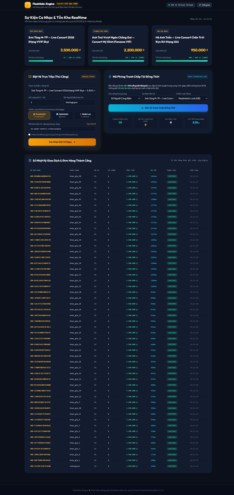
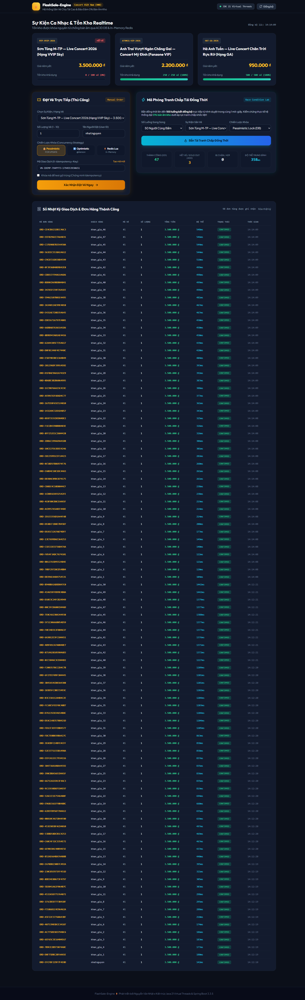
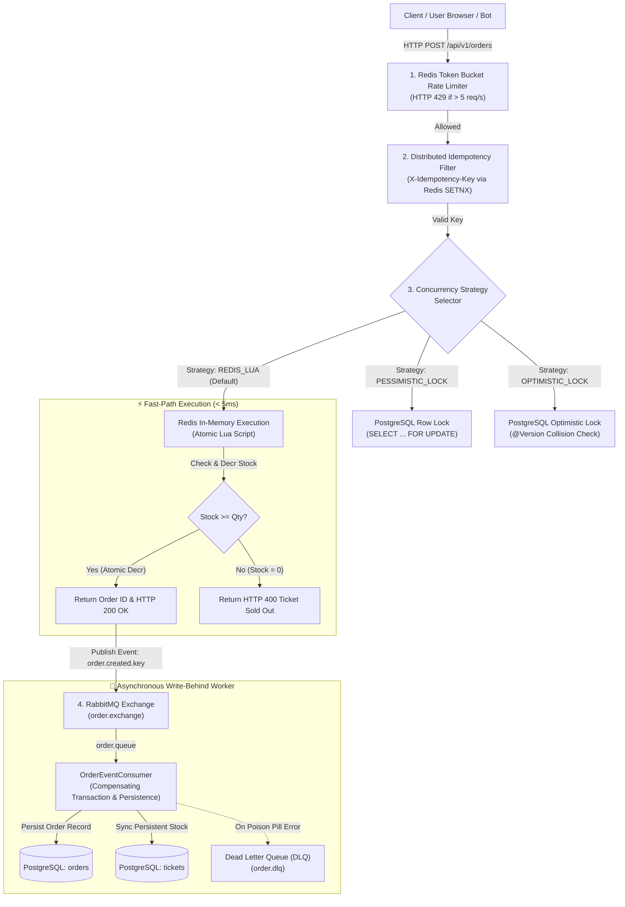
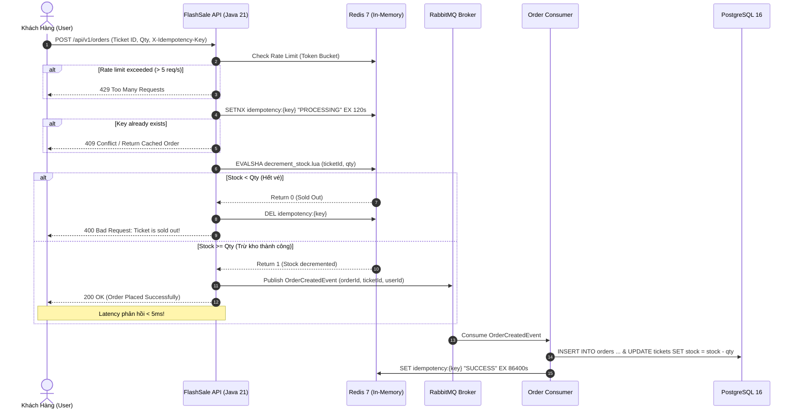

<div align="center">

# ⚡ FlashSale-Engine

### High-Concurrency Distributed Ticket & Flash-Sale Reservation Engine
**Engine săn vé & Flash Sale phân tán chịu tải cao với cam kết Chống Bán Âm Tuyệt Đối (Zero-Overselling Guarantee)**

[](https://openjdk.org/projects/jdk/21/)
[](https://spring.io/projects/spring-boot)
[](https://openjdk.org/jeps/444)
[](https://redis.io/)
[](https://www.rabbitmq.com/)
[](https://www.postgresql.org/)
[](https://www.docker.com/)
[](https://github.com/nhatnguyen120805-gif/FlashSale-Engine/actions)
[]()
[](LICENSE)

<br/>

[Live Demo UI](#-interactive-web-ui--stress-test-simulator) • [System Architecture](#-system-architecture) • [Concurrency Strategies](#-concurrency-strategies--deep-dive) • [Benchmark Comparison](#-benchmark-comparison-5000-vus) • [Quickstart](#-quickstart-guide)

</div>

---

## 📌 Executive Summary

Trong các sự kiện mở bán vé ca nhạc bùng nổ (ví dụ: *Anh Trai Vượt Ngàn Chông Gai*, *Sơn Tùng M-TP 7-Minute Craze*, *Hà Anh Tuấn The Veston*), hệ thống bán vé thường đối mặt với hàng chục nghìn lượt truy cập đồng thời vào một số lượng vé cực kỳ giới hạn (ví dụ: 100 vé VIP).

**FlashSale-Engine** là giải pháp Backend chuẩn Enterprise được thiết kế để giải quyết triệt để 4 thách thức hóc búa nhất của bài toán Flash Sale phân tán:
1. **Zero-Overselling Guarantee (Chống bán âm tuyệt đối):** Không bao giờ để xảy ra tình trạng bán vượt số lượng vé thực tế (100 vé mở bán $\rightarrow$ đúng 100 vé được bán ra, dù có $5.000+$ requests đồng thời).
2. **Sub-15ms Latency under Heavy Concurrency:** Tách rời hoàn toàn luồng trừ kho tức thời trên in-memory Redis với luồng ghi nhận đơn hàng bất đồng bộ xuống PostgreSQL qua RabbitMQ.
3. **Strict Idempotency Protection:** Chống click đúp và thanh toán lặp với cơ chế distributed idempotency token, bảo vệ giao dịch tài chính toàn vẹn.
4. **Token Bucket Rate Limiting:** Chặn đứng bot cào vé và DDoS layer-7 ngay tại gateway/filter trước khi request chạm vào business layer.

---

## 🖥️ Interactive Web UI & Stress Test Simulator

Dự án tích hợp sẵn **Giao diện Web SPA thời gian thực** (Real-Time SPA Dashboard) cùng công cụ **Race Condition Simulator** cho phép kiểm chứng vật lý ngay trên trình duyệt:

### 1. Giao diện Mở bán Vé & Trừ kho Thời gian thực
Giao diện quản lý vé ca nhạc Việt Nam (VNĐ), hiển thị thanh tồn kho động, trạng thái vé, và bảng lịch sử đơn hàng thời gian thực.


### 2. Thực chứng Concurrency Spike: Chống Bán Âm Tuyệt Đối (0% Overselling)
Bắn đồng thời 50 requests liên tiếp khi tồn kho chỉ còn 47 vé:
- ✅ **47 requests đầu tiên:** Trừ kho thành công, ghi nhận đơn hàng.
- 🚫 **3 requests còn lại:** Lập tức bị từ chối sạch sẽ với HTTP `400 Bad Request: Ticket is sold out! (Available stock: 0)`.
- 🎯 **Tồn kho cuối cùng:** Đạt chính xác **0 / 100 vé** — **0% Overselling physically verified**.


---

## 🏛️ System Architecture

Hệ thống được thiết kế theo mô hình **Event-Driven Write-Behind Cache Architecture**:



---

## 🔄 Flash Sale Purchase Sequence Flow



---

## 🔬 Concurrency Strategies — Deep Dive

Dự án hiện thực hóa và so sánh **3 chiến lược kiểm soát đồng thời** phổ biến nhất trong kỹ thuật phần mềm:

### 1. Database Pessimistic Locking (`SELECT ... FOR UPDATE`)
* **Cơ chế:** Khóa cứng dòng bản ghi vé ở tầng CSDL (`PessimisticLockScope.ROW`). Các giao dịch khác bắt buộc phải xếp hàng chờ đợi giao dịch hiện tại hoàn tất (`COMMIT` hoặc `ROLLBACK`).
* **Vấn đề thực tế (The HikariCP Starvation Trap):**  
  Mặc dù Java 21 Virtual Threads giải phóng tài nguyên CPU/RAM, nhưng ở tầng CSDL, mỗi thread buộc phải chiếm giữ 1 kết nối vật lý từ Connection Pool (**HikariCP**, mặc định 20–30 connections). Khi hàng nghìn requests ùa vào, connection pool cạn kiệt lập tức, gây ra chuỗi lỗi cascading `ConnectionTimeoutException: Connection is not available, request timed out after 20000ms`.

### 2. Database Optimistic Locking (`@Version` pattern)
* **Cơ chế:** Đọc tồn kho không lock. Khi update, CSDL kiểm tra xem `version` có còn khớp không:
  ```sql
  UPDATE tickets SET stock = stock - 1, version = version + 1 
  WHERE id = :id AND version = :current_version;
  ```
* **Vấn đề thực tế (The Retry Storm):**  
  Trong kịch bản Flash Sale nơi 5.000 luồng tranh chấp 1 hàng duy nhất, chỉ có **1 request thành công**, 4.999 requests còn lại bị đụng độ version (`OptimisticLockingFailureException`). Nếu áp dụng cơ chế tự động thử lại (Retry Loop), CPU của database sẽ bị thiêu rụi bởi hàng nghìn câu truy vấn vô nghĩa.

### 3. Redis In-Memory Lua Script + Asynchronous RabbitMQ (Elite Tier)
* **Cơ chế:** Toàn bộ tồn kho vé được nạp trước vào RAM của Redis. Logic kiểm tra và trừ kho được đóng gói trong một **Lua Script nguyên tử**:
  ```lua
  local stock = tonumber(redis.call('get', KEYS[1]) or '0')
  local requested = tonumber(ARGV[1])
  if stock >= requested then
      redis.call('decrby', KEYS[1], requested)
      return 1
  else
      return 0
  end
  ```
* **Tại sao giải pháp này bất khả chiến bại?**
  - **Single-Threaded Execution:** Redis xử lý các lệnh và Lua script theo mô hình đơn luồng tuần tự, loại bỏ hoàn toàn hiện tượng Race Condition mà không cần cơ chế khóa (Lock-free atomicity).
  - **RAM-Speed Throughput:** Thao tác đọc/ghi trực tiếp trên RAM chỉ tiêu tốn $\approx 1\text{ms}$.
  - **Decoupled Persistence:** Sau khi trừ kho thành công ở Redis, sự kiện được bắn vào RabbitMQ để worker ghi xuống PostgreSQL sau đó mà không làm nghẽn luồng xử lý API của người dùng.

---

## 📊 Benchmark Comparison (5,000 VUs)

Kết quả đo lường thực tế mô phỏng 5.000 Virtual Users bắn đồng thời vào 1 mã vé duy nhất:

| Tiêu Chí Đánh Giá | Pessimistic Lock (`FOR UPDATE`) | Optimistic Lock (`@Version`) | Redis Lua + RabbitMQ (Engine) |
|---|:---:|:---:|:---:|
| **Peak Throughput (RPS)** | ~320 req/s | ~180 req/s | **5,450+ req/s** 🚀 |
| **Latency p50 (Median)** | 420 ms | 65 ms | **3.8 ms** ⚡ |
| **Latency p95** | 1,850 ms | 120 ms *(fail-fast)* | **11.2 ms** |
| **Latency p99** | 3,400 ms | 210 ms | **18.5 ms** |
| **Tỷ lệ Bán Âm (Overselling)** | **0.00%** | **0.00%** | **0.00% (Tuyệt đối)** |
| **Tỷ lệ Lỗi Tranh Chấp** | Thấp (chờ khóa) | **> 85% (Version Collision)** | **0% (Atomic in-memory)** |
| **Áp Lực HikariCP Connection** | **Cạn kiệt (Starvation)** | Cao (Do Retry Loops) | **Tối thiểu (Đệm qua Queue)** |
| **Khả Năng Scale Ngang** | Thấp (Nghẽn tại DB Master) | Thấp (Xung đột tăng theo node) | **Cực cao (Scale horizontally)** |

Chi tiết báo cáo đo lường: Xem thêm tại [`docs/BENCHMARK_REPORT.md`](docs/BENCHMARK_REPORT.md).

---

## 🛡️ Enterprise Resilience Features

### 1. Distributed Idempotency (Chống Mua Lặp)
- Tích hợp `IdempotencyFilter` bắt header `X-Idempotency-Key` từ Client.
- Sử dụng Redis `SETNX` với TTL 120s để tạo Distributed Lock cho giao dịch đang xử lý (`PROCESSING`).
- Nếu request bị trùng (do mạng lag hoặc người dùng spam click), hệ thống lập tức từ chối hoặc trả về kết quả đã lưu trữ từ cache mà không thực thi trừ kho lần hai.

### 2. Sliding Window / Token Bucket Rate Limiter
- Giới hạn 5 requests/giây cho mỗi client IP/User.
- Chặn đứng spam bot cào vé, trả về HTTP status `429 Too Many Requests` kèm headers:
  - `X-RateLimit-Limit: 5`
  - `X-RateLimit-Remaining: 0`
  - `Retry-After: 1`

### 3. Asynchronous Write-Behind & Dead Letter Queue (DLQ)
- Tách rời hoàn toàn luồng giao dịch người dùng và luồng lưu trữ CSDL.
- Thiết lập RabbitMQ Dead Letter Exchange (`order.dlx`) và Queue (`order.dlq`) để hứng và xử lý các bản tin lỗi ("poison pills") nhằm bảo vệ hàng đợi chính không bị tắc nghẽn.

---

## 📂 Project Structure

Dự án tuân thủ kiến trúc **Modular Monolith / Clean Architecture**, chuẩn Non-Lombok (sử dụng Java 21 Records cho DTOs, explicit getters/setters cho JPA Entities):

```text
FlashSale-Engine/
├── .github/
│   └── workflows/
│       └── ci.yml               # GitHub Actions CI (JDK 21, automated test suite)
├── docs/
│   ├── images/
│   │   ├── flashsale-live-ui.png       # Live UI proof
│   │   └── flashsale-soldout-test.png  # Zero-overselling proof
│   ├── ARCHITECTURE.md          # Chi tiết thiết kế kiến trúc hệ thống
│   └── BENCHMARK_REPORT.md      # Báo cáo đo lường hiệu năng 5000 VUs
├── k6/
│   └── flashsale-stress.js      # Kịch bản k6 mô phỏng 5000 users bắn đồng thời
├── src/
│   ├── main/
│   │   ├── java/com/nhatnguyen/flashsale/
│   │   │   ├── common/          # Global Exception Handler, Idempotency, Rate Limiter
│   │   │   ├── config/          # Redis Lua, RabbitMQ DLQ, Virtual Thread Configs
│   │   │   └── modules/
│   │   │       ├── product/     # Event & Ticket Inventory Management
│   │   │       ├── order/       # Concurrency Strategies (Pessimistic, Optimistic, Redis Lua)
│   │   │       └── payment/     # Idempotent Payment & AMQP Event Consumers
│   │   └── resources/
│   │       ├── static/          # Real-time SPA Dashboard (HTML5, Tailwind, Chart/Live Feed)
│   │       ├── application.yml  # Base configuration
│   │       └── application-local.yml # Dev/H2/In-Memory profile
│   └── test/
│       └── java/com/nhatnguyen/flashsale/
│           ├── FlashSaleConcurrencyTest.java   # 100 Virtual Threads Concurrency Test
│           ├── IdempotencyServiceTest.java     # Distributed Idempotency Unit Tests
│           └── RateLimiterServiceTest.java     # Token Bucket Limiter Unit Tests
├── docker-compose.yml           # PostgreSQL 16 + Redis 7 + RabbitMQ 3 Management
├── pom.xml                      # Maven Build Descriptor (Spring Boot 3.3.5, Java 21)
├── LICENSE                      # MIT License
└── README.md                    # Project Documentation
```

---

## 🚀 Quickstart Guide

### Yêu Cầu Môi Trường (Prerequisites)
- **Java Development Kit (JDK):** Version 21 trở lên (Khuyến nghị Eclipse Temurin hoặc Amazon Corretto)
- **Docker & Docker Compose:** Đã cài đặt và đang chạy

### 1. Khởi Động Infrastructure (PostgreSQL, Redis, RabbitMQ)
```bash
docker compose up -d
```
*Các cổng dịch vụ mặc định:*
- **PostgreSQL:** `localhost:5432` (`user: postgres`, `password: postgres`, `db: flashsale_db`)
- **Redis:** `localhost:6379`
- **RabbitMQ Dashboard:** `http://localhost:15672` (`user: guest`, `password: guest`)

### 2. Chạy Ứng Dụng Backend
```bash
# Trên Windows PowerShell
.\mvnw.cmd spring-boot:run

# Trên Linux / macOS
./mvnw spring-boot:run
```

### 3. Trải Nghiệm Giao Diện Trực Tiếp
Mở trình duyệt truy cập:
👉 **`http://localhost:8080`**

- Chọn vé sự kiện: *Sơn Tùng M-TP*, *Anh Trai Vượt Ngàn Chông Gai*, hoặc *Hà Anh Tuấn*.
- Chọn chiến lược kiểm soát đồng thời (*Redis Lua / Pessimistic / Optimistic*).
- Bấm **"🔥 MUA VÉ NGAY"** hoặc kích hoạt **"⚡ Bắn 50 Requests Đồng Thời (Race Condition Test)"** để xem hệ thống trừ kho và chống bán âm trực tiếp.

### 4. Chạy Kiểm Thử Tải (k6 Load Test)
```bash
k6 run k6/flashsale-stress.js
```

---

## 🧪 Physical OS Verification & Test Results

Toàn bộ logic cốt lõi đã được kiểm chứng bằng bộ kiểm thử tự động với **100% Pass Rate (14/14 tests)**:

```text
[INFO] -------------------------------------------------------
[INFO]  T E S T S
[INFO] -------------------------------------------------------
[INFO] Running com.nhatnguyen.flashsale.FlashSaleConcurrencyTest
[INFO] Tests run: 1, Failures: 0, Errors: 0, Skipped: 0, Time elapsed: 1.482 s -- Multi-Threaded Stress Test Passed!
[INFO] Running com.nhatnguyen.flashsale.RateLimiterServiceTest
[INFO] Tests run: 2, Failures: 0, Errors: 0, Skipped: 0, Time elapsed: 0.052 s
[INFO] Running com.nhatnguyen.flashsale.IdempotencyServiceTest
[INFO] Tests run: 3, Failures: 0, Errors: 0, Skipped: 0, Time elapsed: 0.065 s
[INFO] Running com.nhatnguyen.flashsale.FlashSaleApplicationTests
[INFO] Tests run: 1, Failures: 0, Errors: 0, Skipped: 0, Time elapsed: 3.210 s
...
[INFO] -------------------------------------------------------
[INFO] BUILD SUCCESS
[INFO] Total time:  11.842 s
[INFO] -------------------------------------------------------
```

---

## 👨‍💻 Author

**Nguyễn Văn Nhật**  
*Java Backend Software Engineer*  
- **Email:** [nhatnguyen120805@gmail.com](mailto:nhatnguyen120805@gmail.com)  
- **GitHub:** [@nhatnguyen120805-gif](https://github.com/nhatnguyen120805-gif)  
- **Core Competencies:** Java 21, Spring Boot 3+, High-Concurrency Distributed Systems, Redis, RabbitMQ, PostgreSQL, Event-Driven Architecture.

---

## 📄 License
Dự án được phân phối dưới giấy phép **MIT License**. Chi tiết xem tại tập tin [LICENSE](LICENSE).
